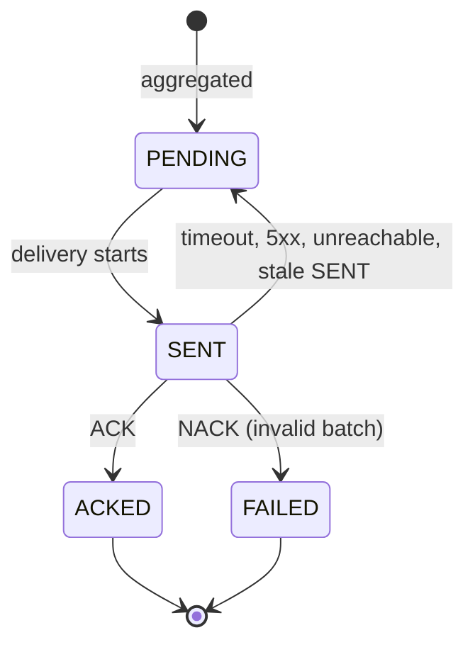

# DS-05: Sync and Consistency Design

Status: approved values, 1 Nov 2026.
Baseline: SRS v1.3, Database Design v1.3, Sprint Backlog v1.4. The API is in DS-04 (`openapi.yaml`).
Traces to: FR02, FR03, FR09, NFR02, NFR03, NFR05; PB-09, 13, 14, 15, 16, 17, 18, 45.

## 1. Goals

- No transaction is lost or counted twice, including on retries and crashes.
- A store keeps selling while HQ or the WAN is down.
- HQ never overwrites local stock.

## 2. Idempotency keys

| Link | Key | Stored in | Same key, same content | Same key, different content |
|---|---|---|---|---|
| POS to Middleware | `transaction_id` | `pos_transaction.txn_id` (PK) | 200 `DUPLICATE_IGNORED` with current stock | 409 `CONFLICT` |
| Middleware to HQ | `sync_batch_id` (`batch_id` in the message) | `hq_sync_batch.sync_batch_id` (PK) | 200 ACK, `duplicate: true`, totals unchanged | 409 NACK `CONFLICT` |

Content hash: SHA-256 as 64 lower-case hex characters, over compact JSON with sorted keys.

- POS event: `store_id`, `pos_id`, `event_type`, `original_transaction_id`, and `items` sorted by `sku`, each with `sku`, `quantity` and `unit_price` to two decimals. `timestamp` is excluded, so a resend has the same hash. A CANCELLATION hashes empty `items`.
- Batch: `batch_id`, `store_id`, `txn_count`, and `lines` sorted by `sku`, with `net_revenue` to two decimals. `created_at` is excluded.

The primary key is the final guard. If two identical events pass the check at the same moment, one insert fails on the key, is rolled back, and is answered as a duplicate.

`sync_batch_id` format: `SB-<store_id>-<yyyyMMddHHmmss UTC>`, at most 28 characters. The same id is kept on every resend.

## 3. POS event processing

All steps run in one database transaction. Nothing in this path calls HQ.

1. Authenticate: client certificate, JWT, POS role (401 or 403).
2. Validate fields and registration (V02 to V05, 422).
3. Duplicate check (V01).
4. Apply business rules (V06 to V09), update `inventory` and batches by FEFO.
5. Save `pos_transaction`, `transaction_item`, `inventory_movement`, `audit_log`, and commit.

Rejected and duplicate events are audited in a separate short transaction. A failed audit write must not change the result of the event.

If the database fails, everything is rolled back and the POS gets 503, so the same `transaction_id` can be resent.

## 4. Aggregation

Runs for each store every `SYNC_INTERVAL` seconds (3600 in production, shorter in demos), or through `POST /sync/run`.

In one database transaction:

1. Select the store's transactions where `sync_batch_id` is empty. Stop for this store if there are none.
2. Create `sync_batch` with status PENDING and `sales_summary_line` rows.
3. Set `pos_transaction.sync_batch_id`, so a transaction is never aggregated twice.

Calculation per SKU:

- `sold_qty`: sum of SALE quantities.
- `returned_qty`: sum of RETURN and CANCELLATION quantities. A CANCELLATION carries the items copied from its sale.
- `net_revenue`: sold amount minus returned amount.

A sale and its cancellation may fall in different batches. This is correct because HQ adds deltas.

## 5. Batch state machine

| HQ answer | New status | Actions |
|---|---|---|
| 200 ACK, including `duplicate: true` | ACKED | Set `acked_at`, write audit |
| 400, 409, 422 (NACK) | FAILED | Save `last_error`, write audit, no automatic resend |
| Timeout, connection error, 5xx | PENDING | `attempts + 1`, save `last_error`, set `next_retry_at` |
| 401, 403, 404, 408, 429 | PENDING | As above, and log it |

The last row refines "4xx" in the SRS. Those codes mean a configuration or capacity problem, not an invalid batch, so failing the batch would lose its data.

Crash recovery: when the worker starts, and before each send cycle, a batch that has been SENT for more than 60 seconds returns to PENDING. HQ's idempotency makes the resend safe.

A FAILED batch is kept for investigation. Its transactions stay linked to it, so they do not join a later batch.

## 6. Sending and retry

- One sender runs at a time, in the same process as the API. `POST /sync/run` joins or skips a cycle that is already running.
- Eligible batches: PENDING with `next_retry_at` empty or due, oldest `created_at` first across all stores.
- Stop the cycle on the first timeout, connection error or 5xx. HQ is treated as down, and order is preserved.
- A FAILED batch does not block the next one.
- Call timeout: 3 seconds.
- Backoff: 1, 2, 4, 8, 16, 32, then 60 minutes, without a limit on attempts. Demos can shorten the base through `SYNC_RETRY_BASE_SECONDS`.

## 7. Offline operation

While HQ is unreachable, POS events, stock queries, Staff API and cross-store lookups use only the local database. Hourly cycles keep adding PENDING batches. When HQ returns, the next due retry sends them oldest first.

## 8. POS buffering during a WAN outage

Applies to the demo POS (PB-45). The link between POS and Middleware is independent of the link to HQ.

- Every event is written to a durable local queue before the first send, so it survives a restart.
- Send the queue in order, one event at a time, with the same `transaction_id`. POS request timeout: 5 seconds.
- Timeout, connection error or 503: keep the event and stop. Retry after 5 seconds.
- `OK` or `DUPLICATE`: remove the event.
- `REJECTED`: move it to a rejected list shown to the cashier, then continue.

Because stock is checked at the Middleware, a sale buffered during an outage can be rejected later with `INSUFFICIENT_STOCK`. The POS shows this to the cashier; it is not retried.

## 9. Delta-only rule

- HQ never writes into `RTS_DB`. It answers ACK or NACK.
- `POST /hq/snapshot` always answers 422 `SNAPSHOT_REJECTED` and writes to `audit_log`. Local stock is unchanged.
- Sync messages carry sales deltas only. HQ adds them to `hq_sales_total`.

## 10. Failure scenarios

| # | Scenario | Expected result | Backlog |
|---|---|---|---|
| 1 | POS times out after the Middleware committed, then resends | `DUPLICATE`, stock changed once | PB-09 |
| 2 | Two identical events at the same moment | One commits, the other answers duplicate | PB-09 |
| 3 | Same `transaction_id`, different items | 409 `CONFLICT`, nothing changes | PB-09 |
| 4 | Duplicate check cannot reach the database | 503, event not applied | PB-09 |
| 5 | Database error during aggregation | No partial batch; transactions join the next cycle | PB-14 |
| 6 | HQ offline for several cycles | Sales continue; batches PENDING; sent oldest first on return | PB-17 |
| 7 | HQ stores the batch, the ACK is lost | Resend gets ACK `duplicate: true`; totals unchanged | PB-16, PB-18 |
| 8 | HQ answers 422 | Batch FAILED; next batch still sent | PB-16 |
| 9 | Same `batch_id`, different content | 409 NACK, batch FAILED, totals unchanged | PB-18 |
| 10 | Middleware crashes while a batch is SENT | Returns to PENDING and is resent; no double count | PB-16 |
| 11 | HQ answers 401 | Batch stays PENDING and is retried | PB-16 |
| 12 | Snapshot arrives during sales | 422; local stock stays correct | PB-13 |
| 13 | WAN lost between POS and Middleware | Events buffered, resent in order, no loss | PB-45, PB-37 |
| 14 | Cancellation in a later batch than its sale | HQ totals are net correct | PB-14, PB-37 |

Each scenario must pass with the HQ demo modes in DS-04 (`ONLINE`, `OFFLINE`, `ERROR`, `SLOW`, `DROP_ACK`).

## 11. Design decisions beyond the SRS

Confirmed on 1 Nov 2026:

1. The timing values and `sync_batch_id` format in this document.
2. Non-batch 4xx answers from HQ keep the batch PENDING.
3. Audit entries for rejected and duplicate events use a separate transaction, because the event transaction was rolled back or never started.
