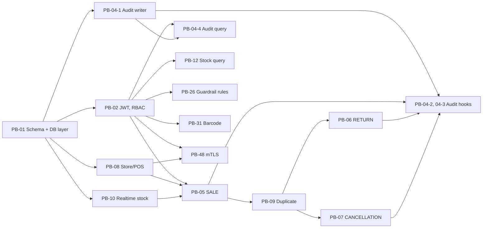

# Kế hoạch Sprint 2

Sprint 2: 31/10 – 13/11/2026. Nguồn: Sprint Backlog v1.4, trạng thái ngày 01/11/2026.

Mục tiêu: POS gửi được SALE, RETURN, CANCELLATION qua API có xác thực; tồn kho đúng theo thời gian thực; không đếm trùng; có audit log.

## Phân công

| Người | Vai trò trong sprint | Backlog | Giờ còn lại |
|---|---|---|---|
| Quang | Luồng bán hàng và tồn kho | PB-05, PB-10, PB-06, PB-04-2 | 37 |
| Khánh | Đăng ký, tra cứu tồn kho, cấu hình guardrail | PB-08, PB-12, PB-26, PB-08-6 (mới) | 33,5 |
| Kiệt | Bảo mật và audit | PB-02, PB-48, PB-04 (trừ PB-04-2) | 30 |
| Sang | Nền dữ liệu, chống trùng, hủy đơn | PB-01-6 (mới), PB-09, PB-07, PB-31 | 28,5 |

Mỗi người có khoảng 48 giờ còn lại (4 giờ/ngày, 12 ngày), nên tải cao nhất là khoảng 77%.

Hai backlog chưa có người được giao như sau:

- **PB-26 cho Khánh:** cùng nhóm Admin API với PB-08, và Khánh phụ trách guardrail ở Sprint 1.
- **PB-31 cho Sang:** Sang có thời gian trống nhất và dùng lại lớp truy cập dữ liệu vừa dựng.

## Thay đổi cần làm trong Backlog

| Task | Thay đổi | Lý do |
|---|---|---|
| PB-01-6 (mới, Sang, 2 giờ) | Kết nối SQL Server, session và repository dùng chung | Mọi service cần, nhưng chưa có task |
| PB-08-6 (mới, Khánh, 1,5 giờ) | Seed sản phẩm, tồn kho, tài khoản demo, rule guardrail mặc định | Seed hiện chỉ có store và POS, chưa test được bán hàng |
| PB-31-2 | Chuyển sang Sprint 3 | Phụ thuộc PB-20 ở Sprint 3 |
| PB-05-2 | Chỉ kiểm tra SKU và số lượng | Kiểm tra store/POS trùng với PB-08-2, PB-08-3 |
| PB-05-3 | Chỉ nối POS event vào service của PB-10 | Trùng với PB-10-1, PB-10-3 |
| PB-09-1 | Còn kiểm thử và bắt lỗi trùng khóa | `txn_id` đã là khóa chính trong migration 001 |

Sau các thay đổi này, tổng giờ task gần như không đổi.

## Phụ thuộc

| Backlog | Cần có trước | Lưu ý |
|---|---|---|
| PB-02 | PB-01 | Kiệt đưa sớm `require_role` để mọi API dùng chung. Đây là điểm chặn lớn nhất |
| PB-08 | PB-01 | Dùng lại code ở repo cũ. API POS phải nhận `cert_fingerprint`. PB-08-2, 08-3 viết thành hàm kiểm tra để PB-05 gọi |
| PB-10 | PB-01-6 | Quang làm trước PB-05-3. PB-10-4 chỉ xong sau PB-06 và PB-07 |
| PB-05 | PB-02, PB-08, PB-10 | Bám đúng DS-04: `event_type`, `quantity`, `unit_price`, `current_stock` |
| PB-09 | PB-05-1 | Sang cùng Quang chốt vị trí kiểm tra trùng trong luồng xử lý |
| PB-06, PB-07 | PB-05, PB-09 | Hai người sửa cùng service: Quang làm RETURN, Sang làm CANCELLATION |
| PB-04-2, 04-3 | PB-04-1, PB-05, PB-09 | Ghi audit trong cùng transaction với sự kiện; sự kiện bị từ chối dùng transaction riêng (DS-05) |
| PB-12, PB-31 | PB-02, PB-08-6 | Giới hạn trong cửa hàng của nhân viên |
| PB-26 | PB-02, PB-08-6 | Theo DS-07 |
| PB-48 | PB-02, PB-08-1 | Cho phép tắt mTLS khi phát triển để không chặn người khác |

## Lịch

| Giai đoạn | Quang | Khánh | Kiệt | Sang |
|---|---|---|---|---|
| **02–04/11: Nền** | PB-10-1, 10-2, 10-3 | PB-08-1, PB-08-6 | PB-02-2, 02-3, 02-4, PB-04-1 | Chạy thử Docker, PB-01-6 |
| **05–08/11: Bán hàng** | PB-05-1 đến 05-5 | PB-08-2, 08-3, 08-5, PB-12 | PB-02-1, 02-5, PB-04-4 | PB-09 |
| **09–11/11: Hoàn thiện** | PB-06, PB-04-2 | PB-26 | PB-48, PB-04-3 | PB-07, PB-31 |
| **12–13/11: Khóa sprint** | PB-10-4, sửa lỗi | Sửa lỗi, demo | PB-04-5, sửa lỗi | Kiểm thử đồng thời, sửa lỗi |

Mốc kiểm tra:

- **04/11:** gọi được API có JWT, DB chạy bằng Docker trên cả 4 máy.
- **08/11:** SALE đi qua toàn bộ luồng, gửi trùng không làm đổi tồn kho.
- **11/11:** đủ 3 loại sự kiện, có audit log.
- **13/11:** demo Sprint 2, mọi test đạt, PR đã merge.

## Quy tắc làm việc

- Mỗi task một nhánh từ `main`, ví dụ `feat/PB-05-sale-event`, merge qua PR có một người review.
- Người chặn việc của người khác thì merge trước, kể cả khi mới có phần tối thiểu.
- Daily 15 phút, báo ngay nếu phụ thuộc trễ quá một ngày.
- Đổi API thì sửa `docs/design/openapi.yaml` trước.
