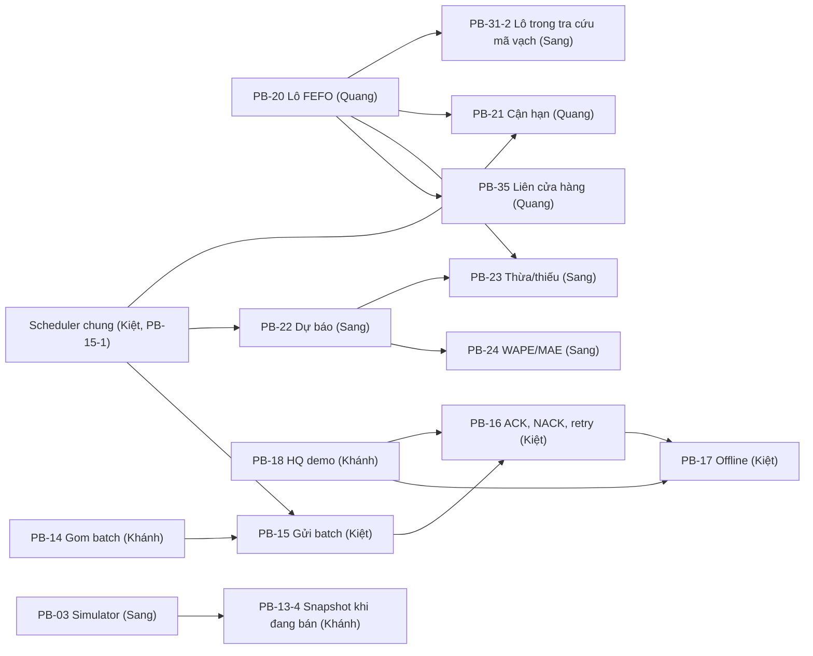

# Kế hoạch Sprint 3

Sprint 3: 14/11 – 27/11/2026. Nguồn: sheet `Sprint 3 Backlog` (Google Sheet), trạng thái ngày 08/11/2026, và code trên `main` tại `6f76b47`.

Mục tiêu: batch doanh số đi từ Middleware lên HQ demo có ACK, retry và chạy offline; POS mô phỏng sinh tải và Demo POS gửi lại khi mất WAN; tồn kho trừ theo lô FEFO; có cảnh báo cận hạn, dự báo nền và tra cứu tồn liên cửa hàng.

## Phân công

| Người | Vai trò trong sprint | Backlog | Giờ |
|---|---|---|---|
| Quang | Tồn kho theo lô và tra cứu | PB-20, PB-10-5 (mới), PB-21, PB-35 | 57 |
| Kiệt | Gửi batch lên HQ | PB-15, PB-16, PB-17 | 46,5 |
| Khánh | Phía HQ và Demo POS | PB-18, PB-14, PB-13, PB-45 | 52 |
| Sang | Mô phỏng và dự báo | PB-03, PB-22, PB-23, PB-24, PB-31-2 | 55,5 |

Tổng 213,5 giờ trên năng lực 224 giờ (95%), gồm 2,5 giờ họp. Mỗi người có 56 giờ (14 ngày × 4 giờ).

- Kiệt thấp nhất vì còn việc PO: review, Sheet, làm việc với mentor.
- PB-45-1 và 45-3 đã xong ở Sprint 2, nên phần việc thật của Khánh khoảng 46,5 giờ.
- Quang vượt 1 giờ vì thêm PB-10-5. Nếu trễ, phần đo thời gian phản hồi của PB-35-5 chuyển sang PB-39 ở Sprint 4.
- Sang ở mức 55,5/56 giờ. Nếu trễ, PB-24-3 (ghi kết quả vào báo cáo) chuyển sang Kiệt.

## Đã có sẵn trên `main`

| Phần | Tình trạng |
|---|---|
| Migration 002 | Đã có `product_batch`, `sales_summary_line`, `near_expiry_config`, `near_expiry_alert`, `forecast`. PB-20-1 và phần migrate của PB-22-1 không còn việc tạo bảng |
| `sync_batch`, `pos_transaction.sync_batch_id` | Đủ cột cho PB-14 đến PB-17 |
| `database/hq/001_hq_tables.sql` | Có bảng HQ, chưa có service, chưa cài vào database nào |
| `openapi.yaml` | Đủ hợp đồng cho `/sync`, `/demo/batches`, `/demo/mode`, `/sync/run`, `/hq/snapshot`, `/admin/near-expiry-thresholds`, `/near-expiry-alerts`, `/products/barcode/{barcode}/stock`, `batches` trong tra cứu tồn và mã vạch |
| `config.py` | Có `hq_url`, `sync_interval`, `sync_retry_base_seconds` |
| Demo POS | 6 terminal, giao diện bán, trả, hủy, hiện kết quả. Chưa có chế độ tự động, CLI, hàng đợi bền |
| Seed | Chưa có lô hàng, chưa có ngưỡng cận hạn, chưa có lịch sử bán |

## Thay đổi trong Backlog

| Task | Thay đổi | Lý do |
|---|---|---|
| PB-10-5 (mới, Quang, 3 giờ) | Truyền tham số varchar cho các câu `text()` để khóa dùng index seek | Issue #25 đã đóng nhưng phần sửa này chưa có trên `main`; deadlock 1205 vẫn trả 503 |
| PB-15-2 | Gửi batch với `sync_batch_id` do PB-14 tạo làm khóa idempotency | Trùng với PB-14-2; PB-14 tạo id vì dòng `sync_batch` được ghi ở đó |
| Owner | Điền theo bảng phân công | |

## Quyết định cho Sprint 3

Ngày 08/11/2026, Kiệt chốt:

1. **Trạng thái cảnh báo cận hạn:** giữ schema migration 002. EXPIRED là `alert_type`; `status` vẫn OPEN cho tới khi lô hết hàng (RESOLVED). "Cảnh báo chuyển sang EXPIRED" trong PB-21 nghĩa là `alert_type` đổi từ NEAR_EXPIRY sang EXPIRED. Không cần migration mới.
2. **Id batch đồng bộ:** PB-14 tạo `sync_batch_id` theo định dạng DS-05 (`SB-<store_id>-<yyyyMMddHHmmss UTC>`); PB-15 chỉ gửi và giữ nguyên id khi gửi lại.
3. **PB-10-5** thuộc Sprint 3, Quang làm cùng PB-20 vì đụng cùng file.
4. **Lịch sử bán mô phỏng (PB-22-1):** nạp thẳng vào `RTS_DB_DEMO` hoặc `RTS_DB_TEST`, không bao giờ vào `RTS_DB`. Giao dịch có `txn_id` bắt đầu bằng `HIST-`, gắn vào một `sync_batch` ACKED riêng cho mỗi cửa hàng (`SB-HIST-<store_id>`) để PB-14 không gom lại và không gửi lên HQ. Không ghi `inventory_movement`, không đổi tồn. PB-40 bỏ các batch `SB-HIST-` khi tính tỉ lệ đồng bộ.
5. **Hoàn kho cho đơn bán trước PB-20:** movement cũ không có `batch_id`, nên RETURN và CANCELLATION của những đơn này hoàn vào lô có `expiry_date` muộn nhất của cửa hàng và SKU đó. Chỉ gặp với dữ liệu cũ trong `RTS_DB`; database demo được reset. Quyết định PO ngày 09/11: khi cửa hàng và SKU chưa có lô nào, vẫn tạo lô `LEGACY-...` nhưng đặt `expiry_date = today_local() - 1 ngày` (thay cho +365 ngày trước đây), nên hàng được cộng lại vào tồn kho nhưng không bán được, và PB-21 cảnh báo EXPIRED để nhân viên kiểm.
6. **Ngày nghiệp vụ:** "hôm nay" khi so hạn dùng giờ Việt Nam (UTC+7), lấy từ một hàm chung `today_local()` để test thay được.

## Phụ thuộc

| Phụ thuộc | Cách giảm |
|---|---|
| PB-20 → PB-31-2, 21, 23, 35 | PB-20 là việc đầu tiên trên đường găng, merge chậm nhất 17/11 |
| PB-14, PB-18 → PB-15, 16, 17 | Hợp đồng đã có (DS-05 mục 4 đến 6, `openapi`, schema). Kiệt test bằng dòng `sync_batch` tự tạo và HQ giả (`httpx.MockTransport`), chỉ cần bản thật cho PB-16-5 và PB-17-4 |
| Scheduler | Kiệt merge khung scheduler trước 16/11. Mỗi job là một hàm chạy một lần, test được không cần scheduler; chỉ một process chạy job (khóa ứng dụng SQL Server) |
| PB-20 sửa cách trừ kho | Mọi test đang tạo `inventory` phải tạo thêm lô. Quang sửa các fixture đó trong PR PB-20; người khác rebase sau khi PB-20 merge |

## Lịch

| Giai đoạn | Quang | Kiệt | Khánh | Sang |
|---|---|---|---|---|
| **5: 14–19/11** | PB-20, PB-10-5 | Scheduler, PB-15, PB-16-1, 16-2 | PB-18, rồi PB-14 | PB-03, PB-22-1, PB-31-2 |
| **6: 20–24/11** | PB-21, PB-35 | PB-16-3 đến 16-5, PB-17, `/sync/run` | PB-13, PB-45 | PB-22-2 đến 22-4, PB-23, PB-24 |
| **7: 25–27/11** | Sửa lỗi, kiểm thử chéo | Kịch bản DS-09 1 đến 5 với HQ thật | Demo Sprint 3, kịch bản 6 và 8 | Kịch bản 7, số liệu dự báo |

Mốc kiểm tra:

- **16/11:** khung scheduler merge.
- **17/11:** PB-20 và PB-18 merge.
- **19/11:** PB-14, PB-15 merge; simulator chạy được với `RTS_DB_DEMO`.
- **24/11:** mọi backlog merge.
- **12:00 26/11:** đóng băng code. Chiều 26/11 diễn tập.
- **27/11:** demo Sprint 3 và retrospective.

## File dùng chung

| File | Quy tắc |
|---|---|
| `compose.yaml` | Giai đoạn 5 chỉ Khánh sửa (service `hq-demo`, biến môi trường HQ và scheduler cho `middleware`) |
| `scripts/generate_dev_certs.sh` | Khánh thêm `hq-demo` và `pos-gateway` vào SAN của chứng chỉ server |
| `middleware/requirements.txt` | Kiệt thêm `httpx`, Sang thêm `scikit-learn` ở giai đoạn 6 |
| `app/core/config.py`, `.env.example`, `app/domain/models.py` | Chỉ thêm dòng, giữ thứ tự |
| `app/main.py` | Kiệt (khởi động scheduler); router mới thêm một dòng |
| `tests/test_auth_matrix.py` | Mỗi route mới thêm một dòng. Giai đoạn 5 không có route mới trong middleware |
| `database/seed/` | Quang: `003_demo_batches.sql` (giai đoạn 5), `004_near_expiry_defaults.sql` (giai đoạn 6) |
| `database/migrate.sh` | Khánh thêm bước cài bảng HQ vào database HQ |

## Quy tắc làm việc

- Giữ như Sprint 2: mỗi task một nhánh từ `main`, PR có review trước khi merge, người chặn việc của người khác merge trước.
- Đổi API thì sửa `docs/design/openapi.yaml` trong commit riêng, trước code.
- Không sửa migration đã áp dụng; cần đổi schema thì thêm file mới và báo nhóm.
- Kiểm tra trực tiếp chỉ trên `RTS_DB_DEMO` hoặc `RTS_DB_TEST`.
- Tên test lấy mã từ file Test case; không có mã thì đặt theo backlog.
- Ghi giờ theo ngày vào Sprint Backlog mỗi ngày.
